# Prototype analysis and traceability

## Actors and permissions

| Actor | Capabilities |
|---|---|
| Admin | Manage scholarship programs, scholars, grades, verify submissions, view all reports and audit logs through SQL Editor |
| Staff | Register/edit scholars, assign programs, submit/verify grades, view compliance |
| Scholar | See own scholar record and grades, submit own grades; cannot verify |

## Major use cases

- **UC-01 Login:** user enters valid credentials; Supabase Auth creates session; role comes from protected profiles table.
- **UC-02 Register Scholar:** staff enters unique Student ID, name, degree, year, active scholarship, status. Server enforces uniqueness and authorization.
- **UC-03 Submit Grades:** linked scholar or staff enters term, GWA, units, failed and incomplete counts; valid record saved as Pending. Duplicate term is rejected.
- **UC-04 Verify Grade Submission:** staff selects pending record; protected RPC locks and verifies once; includes **Evaluate Academic Compliance**.
- **UC-05 Evaluate Academic Compliance:** program-specific GWA threshold, minimum units, failing-grade flag and zero incompletes are evaluated in SQL; **Record Deficiency** extends this use case when a rule fails.
- **UC-06 Monitor Compliance:** user views authorized records and their status; dashboard counts and filters are calculated from live database reads.

## ERD (Mermaid)

```mermaid
erDiagram
 AUTH_USERS ||--|| PROFILES : owns
 AUTH_USERS o|--o| SCHOLARS : linked_login
 SCHOLARSHIP_PROGRAMS ||--o{ SCHOLARS : assigned_to
 SCHOLARS ||--o{ GRADE_SUBMISSIONS : submits
 AUTH_USERS ||--o{ GRADE_SUBMISSIONS : submitted_by
 AUTH_USERS ||--o{ AUDIT_LOGS : performs
 GRADE_SUBMISSIONS ||--o{ AUDIT_LOGS : recorded_in
```

## Requirements to features

| Requirement | Use Case | Implemented Feature | Test |
|---|---|---|---|
| FR-01 | Register Scholar | Scholar form with RLS | TC-02, TC-03 |
| FR-02 | Assign Scholarship | Program selector | TC-02 |
| FR-03 | Configure Requirements | Admin program form | Manual |
| FR-04 / FR-05 | Submit Grades | Term-based grade form | TC-04 |
| FR-06 | Verify Submission | Staff-only RPC | TC-05 |
| FR-07 / FR-08 | Evaluate / Record Deficiency | Atomic compliance function | TC-06, TC-07 |
| FR-09 | Update Scholar Status | Function updates status | TC-06, TC-07 |
| FR-10 | Pending Monitoring | Live dashboard totals | TC-04 |
| FR-11 | Search Scholars | Search by name/ID | TC-08 |
| FR-12 | Filter Scholars | Program/status filters | TC-09 |
| FR-13 | Secure Authentication | Supabase Auth + RLS | TC-01 |
| FR-14 | Audit Verification | audit_logs insert on verification | SQL Editor |
| FR-15 | View Compliance | Compliance page | TC-06, TC-07 |

**Important:** This document describes the implemented prototype; the laboratory's full Part I worksheet and final formal UML diagram still need to be completed and submitted separately.
